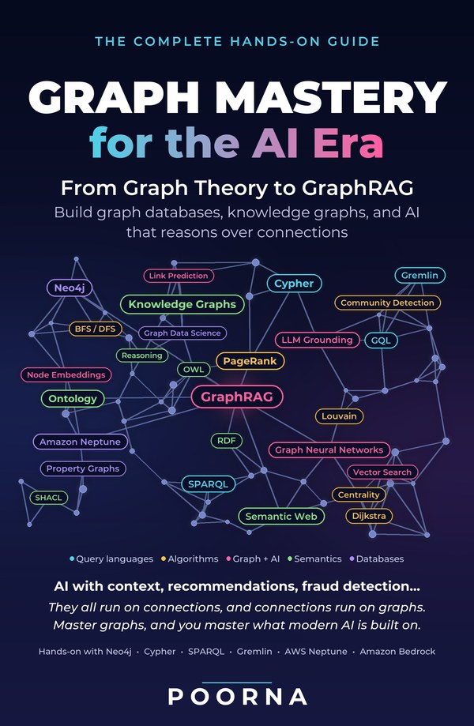

<p align="center">
  <a href="https://www.amazon.com/Graph-Mastery-Era-Databases-Connections/dp/B0HNTP3TBM"></a>
</p>

<h1 align="center">Graph Mastery Labs</h1>

<p align="center">
  The companion code for <b><i>Graph Mastery for the AI Era</i></b><br>
  <i>From Graph Theory to GraphRAG: Build Graph Databases, Knowledge Graphs, and AI That Reasons Over Connections</i><br>
  by Poorna
</p>

<p align="center">
  <a href="https://www.amazon.com/Graph-Mastery-Era-Databases-Connections/dp/B0HNTP3TBM"></a>
</p>

## About the book

AI with context, recommendations, fraud detection: they all run on
connections, and connections run on graphs. *Graph Mastery for the AI Era*
takes you from your first node to production GraphRAG in one continuous,
hands-on path, building every idea from first principles and running real
code on a free, open-source stack. This repository is that code.

**You'll learn to:**

- Think in graphs and pick the right algorithm: BFS, Dijkstra, PageRank, Louvain
- Model and query graphs in Cypher, SPARQL, Gremlin, and GQL
- Build knowledge graphs with RDF, OWL ontologies, SHACL, and reasoning
- Design graph models, ETL pipelines, APIs, and visualizations for real applications
- Ground LLMs with GraphRAG: multi-hop, cited, explainable answers
- Train graph neural networks and build knowledge graphs from text with LLMs
- Run graphs in production: Neo4j in depth, and the cloud on AWS Neptune and Amazon Bedrock

**Who it's for:** software, data, and AI/ML engineers, architects, and
career-switchers. All you need is basic programming in any language: no prior
graph, database, or advanced math experience.

The book has 15 chapters in seven parts, 68 diagrams, end-of-chapter
exercises with full worked solutions, and an end-to-end GraphRAG build.
Get your copy here:
**[Graph Mastery for the AI Era on Amazon](https://www.amazon.com/Graph-Mastery-Era-Databases-Connections/dp/B0HNTP3TBM)**.

## What's in this repository

Every code listing in the book, every *Try It Yourself* lab with its data and
a worked solution, the end-to-end GraphRAG example from Appendix E, and the
capstone rubric, briefs, and interview bank from Chapter 15.

Everything runs on your own machine with free, open-source software. No paid
account is needed: the labs that use a language model also run in an
offline mode, and you can plug in a local model (Ollama) or Claude when you
want real generation.

## Quick start

You need Docker Desktop (running), Python 3.10+, and Git.

```bash
git clone https://github.com/Poornacodes/graph-mastery-labs.git
cd graph-mastery-labs
./scripts/setup.sh            # Python env, Neo4j + Fuseki, smoke test
source .venv/bin/activate
```

`setup.sh` is the one-command version of Appendix A. Add `--gremlin` to also
start JanusGraph for the Gremlin labs. On Windows, run the same steps by
hand: `python -m venv .venv`, `.venv\Scripts\activate`,
`pip install -r requirements.txt`, `docker compose up -d`,
`python scripts/smoke_test.py`.

Neo4j Browser is at http://localhost:7474 (user `neo4j`, password
`graphmastery`); Fuseki at http://localhost:3030.

## Where everything is

| Book | Folder | What's there |
|---|---|---|
| Ch 2 | `ch02-graph-theory/` | Try It 2.1 with a NetworkX solution |
| Ch 3 | `ch03-algorithms/` | Listings 3.1–3.6; Try It 3.1 (karate club, renders Figure 3.7) |
| Ch 4 | `ch04-neo4j/` | Listings 4.1–4.9 with seed data; Try It 4.1 movie-ratings lab with an index-seek check; `pg_vs_neo4j.py`, the PostgreSQL-versus-Neo4j comparison of §4.1.1 (Table 4.1) |
| Ch 5 | `ch05-query-languages/` | Listings 5.1–5.6 in Cypher, Gremlin, SPARQL, and GQL; Try It 5.1 runs all three |
| Ch 6 | `ch06-knowledge-graphs/` | Listings 6.1–6.5 as Turtle; Try It 6.1 (reasoning and SHACL) |
| Ch 7 | `ch07-modeling-etl/` | Dataset generator, Listing 7.1 loader, Try It 7.1 idempotency check |
| Ch 8 | `ch08-fullstack-app/` | Listings 8.1–8.4: FastAPI recommender, vis-network page, tests; the explainable variant from Try It 8.1 |
| Ch 9 | `ch09-graphrag/` | Minimal GraphRAG (Section 9.4): Listings 9.1–9.2, with a vector-only A/B (Try It 9.1) |
| Ch 10 | `ch10-graph-ml/` | Listing 10.1 (GDS node2vec), 10.2 (link prediction, completed), 10.3 (GCN on Cora, optional) |
| Ch 11 | `ch11-llm-kg/` | Listings 11.1–11.2; Try It 11.1: extract, resolve, load, query, validate |
| Ch 12 | `ch12-production/` | Listing 12.1 Compose stack; Try It 12.1 steps and RPO/RTO journal |
| Ch 13 | `ch13-neptune/` | Neptune notebook (Listings 13.1–13.2), the two reference architectures (Listings 13.3–13.4, `ARCHITECTURE.md`), bulk-load files, teardown checklist, and a free local path (Try It 13.1) |
| Ch 14 | `ch14-neo4j/` | Neo4j operations labs (Try It 14.1): memory sizing (Listing 14.1, `memory.sh`), PROFILE diagnosis and fix (Listing 14.2, `profile_lab.py`), `neo4j-admin` bulk import of 1M nodes / 5M relationships (Listing 14.3, `admin_import.sh`), offline backup and verified restore (Listing 14.4, `backup_restore.sh`) |
| Ch 15 | `ch15-capstones/` | Full rubric (Table 15.2), three capstone briefs, interview bank, two-minute-story template |
| App E | `examples/athena/` | Athena, the end-to-end GraphRAG knowledge platform |

Appendix A's setup is `docker-compose.yml`, `requirements.txt`, and
`scripts/setup.sh`. Chapter 1 has no code: its Try It is a paper exercise you
build in Chapter 4.

## Language models (Chapters 9, 11, Appendix E)

Set `LLM_PROVIDER` in `.env`:

| Value | What it uses | Setup |
|---|---|---|
| `offline` (default) | No model. Extraction replays recorded model output; answers show the grounded context. | Nothing |
| `ollama` | A local model, free | Install Ollama, `ollama pull llama3.1` |
| `anthropic` | Claude via the Anthropic API (default model `claude-opus-5-5`) | `pip install -r requirements-llm.txt`, set `ANTHROPIC_API_KEY` |
| `bedrock` | Claude on Amazon Bedrock (Chapter 13) | `pip install -r requirements-llm.txt`, AWS credentials, `AWS_REGION` |

`LLM_MODEL` overrides the model name. All calls go through
`graphlab/llm.py`'s `call_llm(prompt)`.

## Notes

- **Shared database.** All labs share one Neo4j database. Each lab clears
  its own labels before it runs, so run them in any order, but a lab's data
  may be gone after you run another.
- **Embeddings.** `sentence-transformers` downloads a ~90 MB model on first
  use. `EMBED_MODEL=hash` is an offline fallback for testing (much weaker
  retrieval).
- **Intel Macs.** PyTorch's last Intel-Mac release is 2.2, so
  `requirements.txt` pins compatible `numpy`, `transformers`, and
  `sentence-transformers` versions on that platform only.
- **`CERTIFICATE_VERIFY_FAILED` on macOS.** The python.org installer ships
  without root certificates. Run *Install Certificates.command* in your
  `/Applications/Python 3.x` folder once, or set
  `export SSL_CERT_FILE=$(python -m certifi)` before running the lab.
- **Cloud labs cost money.** Neptune is not free-tier eligible. Follow
  `ch13-neptune/TEARDOWN.md` after every AWS session.
- **Verify the moving parts.** Cloud services, AI tooling, and prices change
  quickly; check current documentation before relying on a specific API.

## Errata and questions

Open an issue on this repository. Corrections to the book's listings are
fixed here first.

If these labs help you, the book explains the *why* behind every one of them:
**[get Graph Mastery for the AI Era on Amazon](https://www.amazon.com/Graph-Mastery-Era-Databases-Connections/dp/B0HNTP3TBM)**. And if you've read
it, a review on Amazon helps other engineers find it.

## License

Code: MIT (see `LICENSE`). The book's text is copyright the author and not
included here.
